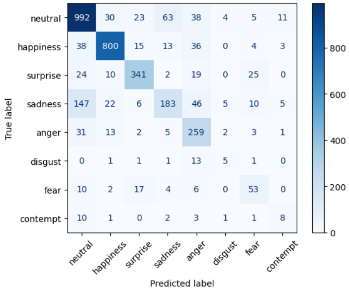
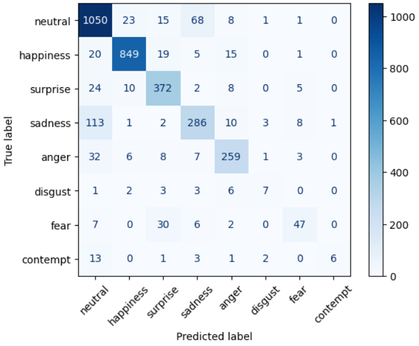

# Live Facial Emotion Detection with a CNN

A CNN trained from scratch to recognize 8 facial emotions, with a script that runs it live on a webcam.

**Test accuracy: 85.2%** on the FER+ test set.

## Results

| | Validation | Test |
|---|---|---|
| Round 1: majority-vote labels | 80.1% | 78.2% |
| **Round 2: vote-distribution labels + TTA** | **86.5%** | **85.2%** |

| Emotion | Precision | Recall | F1 |
|---|---|---|---|
| neutral | 0.833 | 0.901 | 0.866 |
| happiness | 0.953 | 0.934 | 0.943 |
| surprise | 0.827 | 0.884 | 0.854 |
| sadness | 0.753 | 0.675 | 0.711 |
| anger | 0.838 | 0.820 | 0.829 |
| disgust | 0.500 | 0.318 | 0.389 |
| fear | 0.723 | 0.511 | 0.599 |
| contempt | 0.857 | 0.231 | 0.364 |

| Round 1 | Round 2 |
|---|---|
|  |  |

## Data

FER-2013 images (48×48 greyscale) with FER+ labels, where 10 people voted on each face. Ambiguous and invalid images were removed, leaving 33,712: 26,940 train, 3,396 validation, 3,376 test.

## Model and training

- VGG-style CNN, 4 convolutional blocks (64 → 128 → 256 → 256 filters) with batch normalization, global average pooling, and a dense layer; about 3.6M parameters.
- Trained on the full vote distribution (e.g. 60% neutral / 40% sadness) rather than a single label.
- AdamW with a cosine learning-rate schedule, 60 epochs, data augmentation, on a Colab T4 GPU.
- Test-time augmentation: each face is predicted as-is and mirrored, and the results are averaged.

## Running it

Requires Python 3.10+ and a webcam.

```bash
git clone <this-repo-url>
cd emotion-detection
python -m venv .venv
.venv\Scripts\activate          # Windows
pip install -r requirements.txt
python live_emotion.py
```

Press **Q** to quit. Requires OpenCV 4.x.

To retrain, run `train_emotions_cnn.ipynb` in Google Colab with `fer2013.csv` (Kaggle) and the [FER+ labels](https://github.com/microsoft/FERPlus).

## Files

| File | Purpose |
|---|---|
| `live_emotion.py` | Live webcam detection |
| `emotion_cnn_v2.keras` | Trained model |
| `train_emotions_cnn.ipynb` | Data preparation and training |
| `requirements.txt` | Dependencies |

## Credits

FER-2013 (Goodfellow et al., 2013) and FER+ (Barsoum et al., 2016, [microsoft/FERPlus](https://github.com/microsoft/FERPlus)).
